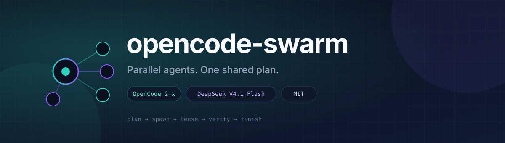
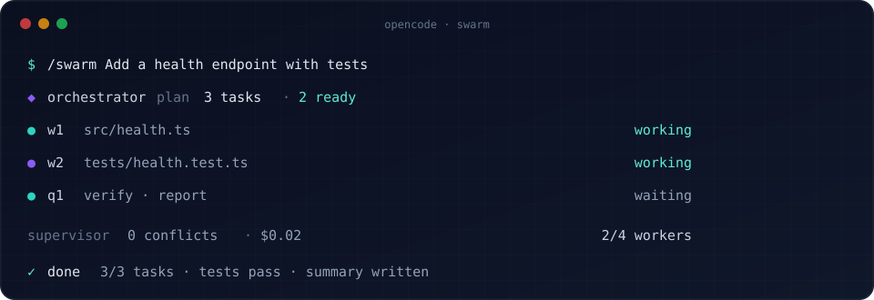
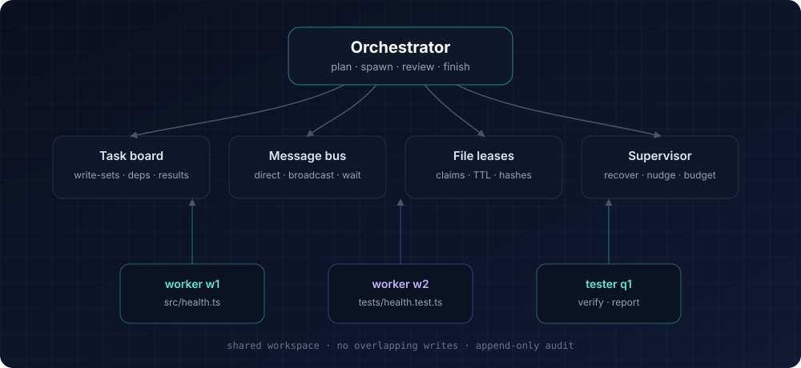

<p align="center">
  
</p>

<p align="center">
  <a href="https://github.com/DumDuky/opencode-swarm/actions/workflows/ci.yml"></a>
  <a href="https://github.com/DumDuky/opencode-swarm/blob/main/LICENSE"></a>
  
  
  
  
</p>

<h1 align="center">opencode-swarm</h1>

<p align="center">
  Parallel agents. One shared plan. A swarm that actually finishes.
</p>

<p align="center">
  <a href="https://dumduky.github.io/opencode-swarm/"><strong>Website</strong></a>
  ·
  <a href="#install"><strong>Install</strong></a>
  ·
  <a href="#how-it-works"><strong>How it works</strong></a>
  ·
  <a href="https://github.com/DumDuky/opencode-swarm/issues"><strong>Issues</strong></a>
</p>

---

`opencode-swarm` turns an OpenCode chat into a supervised multi-agent swarm.

Give it one goal. It plans tasks, spawns workers in parallel, keeps them from overwriting each other, lets them message each other, and wakes the orchestrator only for decisions that matter. When the work is done it verifies the result and closes the swarm.

- **Parallel by default.** Multiple child sessions work at the same time.
- **File-safe.** Plan-time write-sets, file leases, and content-hash checks.
- **Peer messaging.** Workers talk directly; the orchestrator is not a relay.
- **Low-friction reviews.** Routine spawns are automatic; only escalations reach the orchestrator.
- **Supervised recovery.** A deterministic loop handles stale locks, idle workers, failures, budgets, and completion.
- **Designed for OpenCode Go.** DeepSeek V4.1 Flash is the default, and role models are configurable.

<p align="center">
  
</p>

---

## Install

### Requirements

- OpenCode **2.x** (tested on 2.2.0; V1 1.19.4 is also supported)
- [Bun](https://bun.sh) 1.4+
- An OpenCode Go account for the default model, or any tool-capable provider

### From source

```bash
git clone https://github.com/DumDuky/opencode-swarm.git
cd opencode-swarm
bun install
```

Add the package to your global `~/.config/opencode/opencode.json`:

```jsonc
{
  "$schema": "https://opencode.ai/config.json",
  "plugins": [
    {
      "package": "/absolute/path/to/opencode-swarm",
      "options": {}
    }
  ],
  "instructions": [
    "/absolute/path/to/opencode-swarm/docs/SWARM.md"
  ]
}
```

Reload OpenCode, then start a swarm from any chat:

```text
/swarm Add a health endpoint with tests
```

`opencode plugin list` should show `opencode-swarm`.

### Single project

Put the same `plugins` entry in the project's `opencode.json` instead of the global config.

### V1 fallback

For OpenCode 1.19.x, copy `examples/local-plugin/swarm.ts` into `.opencode/plugins/swarm.ts` and restart OpenCode. V1 also registers the dedicated `swarm`, `swarm-worker`, `swarm-tester`, `swarm-scout`, `swarm-reviewer`, `swarm-planner`, and `swarm-integrator` agents.

### From npm

The package is not published yet. Once it is, the entry becomes:

```jsonc
{
  "plugins": [{ "package": "opencode-swarm", "options": {} }]
}
```

---

## How it works

<p align="center">
  
</p>

1. **Plan.** The orchestrator creates tasks with exact file write-sets, acceptance criteria, dependencies, and a size.
2. **Validate.** The board rejects overlapping write-sets unless a dependency orders the tasks.
3. **Spawn.** Workers get their own child sessions, a focused brief, and a role.
4. **Work.** Workers claim files, edit, test, and message each other.
5. **Supervise.** The supervisor expires leases, nudges idle workers, retries failures, enforces budgets, and wakes the orchestrator when a decision is needed.
6. **Finish.** The orchestrator verifies, integrates, and closes the swarm with a summary and test evidence.

### Why it does not overwrite itself

Three layers protect the shared workspace:

| Layer | What it does |
|---|---|
| **Plan-time partition** | Open tasks cannot claim the same files unless one depends on the other. |
| **File leases** | A worker must own a file or directory before editing it. Directory and file leases conflict correctly. |
| **Content-hash guard** | If a file changed since the worker last read it, the edit is rejected and the worker must re-read. |

Same-file edits serialize. That is intentional. Worktree isolation and a merge queue are the next major addition.

---

## Commands

| Command | Purpose |
|---|---|
| `/swarm <goal>` | Start a swarm, or resume a paused one. |
| `/swarm-status` | Show members, tasks, leases, approvals, and budget. |
| `/swarm-stop` | Stop the swarm and interrupt workers. |
| `/swarm-approve <id> [reason]` | Approve a pending escalation. |
| `/swarm-deny <id> [reason]` | Deny a pending escalation. |

You can also call `swarm_start` directly from any chat to keep the current agent.

## Tools

| Tool | Purpose |
|---|---|
| `swarm_start` | Create the swarm and become the orchestrator. |
| `swarm_task` | Create, list, claim, update, or release tasks. |
| `swarm_spawn` | Spawn a worker, tester, scout, reviewer, planner, or integrator. |
| `swarm_message` | Send, broadcast, read, or wait for messages. |
| `swarm_files` | Claim, release, or list file leases. |
| `swarm_status` | Compact swarm dashboard. |
| `swarm_wait` | Wait for members or tasks and return summaries. |
| `swarm_finish` | Finish a task or close the swarm with evidence. |
| `swarm_review` | Orchestrator-only approval queue. |
| `swarm_stop` | Stop one member and its subtree, or the whole swarm. |

---

## Autonomy

This is **goal-driven, supervised autonomy**.

After you give a goal, the swarm can plan, spawn, coordinate, recover, verify, and finish without you approving each step. The supervisor wakes the orchestrator when tasks are ready, blocked, failed, finished, or waiting for review.

It is not an unbounded daemon:

- It needs a goal.
- It stops when done, stopped, over budget, or over the configured limits.
- Destructive actions are blocked or escalated.
- The permission model is not a sandbox.

### Approvals

Default policy: **balanced**.

| Action | Decision |
|---|---|
| First-level spawn within limits | Allow |
| Claim a free file | Allow |
| Create/claim tasks, send messages | Allow |
| Spawn a sub-subagent | Orchestrator review |
| Burst spawns or high member count | Orchestrator review |
| Directory-wide lease | Orchestrator review |
| Budget warning | Orchestrator review |
| Hard budget | Deny / pause |
| Destructive shell or outside workspace | Block or human approval |

The orchestrator is told to approve routine work by default and deny only for concrete safety, cost, or correctness reasons.

---

## Configuration

V2: put the options in the `plugins` entry. V1: use `swarm.config.json`.

```jsonc
{
  "models": {
    "orchestrator": "opencode-go/deepseek-v4.1-flash",
    "worker": "opencode-go/deepseek-v4.1-flash",
    "scout": "opencode-go/deepseek-v4.1-flash#low",
    "reviewer": "opencode-go/deepseek-v4.1-flash#high",
    "planner": "opencode-go/deepseek-v4.1-flash#high",
    "tester": "opencode-go/deepseek-v4.1-flash",
    "integrator": "opencode-go/deepseek-v4.1-flash#high"
  },
  "limits": {
    "maxMembers": 8,
    "reviewAtMembers": 6,
    "maxDepth": 2,
    "maxConcurrent": 4,
    "maxMessagesPerMinute": 10,
    "maxMessageLength": 4000,
    "maxTaskAttempts": 2
  },
  "budget": {
    "maxCostUsd": 3,
    "maxTokensPerTask": 0,
    "warnAt": 0.7,
    "pauseAt": 0.9
  },
  "leases": {
    "ttlMs": 600000,
    "autoClaim": true
  },
  "approval": {
    "mode": "balanced",
    "timeoutMs": 120000,
    "onTimeoutMedium": "allow",
    "onTimeoutHigh": "deny"
  }
}
```

`maxTokensPerTask: 0` disables the per-task token guard. Cost is tracked separately.

Set `models.orchestrator` to `"inherit"` if you want the orchestrator to follow the session model selected with `/models`.

---

## Examples

| Example | What it shows |
|---|---|
| [`examples/tiny-demo`](examples/tiny-demo) | Two parallel workers plus a dependency-gated tester. |
| [`examples/dynamic-write-set`](examples/dynamic-write-set) | A worker asks the orchestrator to expand its write-set. |
| [`examples/cwd-independent-check`](examples/cwd-independent-check) | Cwd-independent verification with a tester. |
| [`examples/health-endpoint`](examples/health-endpoint) | A tiny HTTP health endpoint with Node tests and a live verification report. |

More detail, including real run results, is in [`docs/e2e-demo.md`](docs/e2e-demo.md).

---

## Development

```bash
bun install
bun run check
```

The test suite covers the task board, message bus, file leases, policy, spawning, approvals, recovery, and persistence.

```text
src/
  index.ts           dual V1/V2 entrypoint
  service.ts         orchestration, spawn, wait, approvals, supervision
  board.ts           tasks and plan validation
  bus.ts             messages, rate limits, loop detection
  leases.ts          file leases, TTLs, content hashes
  policy.ts          spawn/file/shell risk policy
  v1/                V1 plugin, runtime, tools, agents, state
  v2/                V2 plugin, runtime, tools, commands
test/
  board.test.ts bus.test.ts leases.test.ts policy.test.ts service.test.ts
```

Issues and PRs are welcome. See [`CONTRIBUTING.md`](CONTRIBUTING.md) and [`SECURITY.md`](SECURITY.md).

---

## Roadmap

- [x] OpenCode V2 and V1 host adapters
- [x] Plan-time write-sets, file leases, and content-hash checks
- [x] Parallel workers with peer messaging
- [x] Orchestrator review queue, supervisor, budgets, and recovery
- [ ] Worktree isolation and a merge queue
- [ ] TUI dashboard for live swarm state
- [ ] npm package
- [ ] Richer plan validation and conflict analysis

## Limitations

- Shared workspace only. Worktree isolation and a merge queue are planned.
- Same-file edits serialize by design.
- No cross-machine distribution.
- Not a security sandbox. Use workspace permissions and `/swarm-stop`.
- The orchestrator is an LLM. The supervisor handles routine recovery, but plan quality still matters.
- V1 ignores model variants; V2 supports them.

## License

MIT. See [`LICENSE`](LICENSE).

If this saves you time, consider starring the repo.

<p align="center">
  <sub>Built for OpenCode. Default model: DeepSeek V4.1 Flash on OpenCode Go.</sub>
</p>
