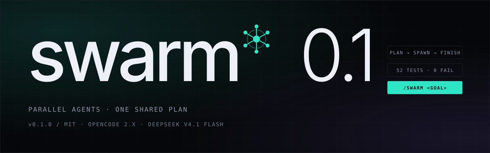

<p align="center">
  
</p>

<p align="center">
  <a href="https://github.com/DumDuky/opencode-swarm/actions/workflows/ci.yml"></a>
  
  
  
  
</p>

<p align="center">
  <a href="https://dumduky.github.io/opencode-swarm/"><strong>Website</strong></a>
  ·
  <a href="#install"><strong>Install</strong></a>
  ·
  <a href="#roles"><strong>Roles</strong></a>
  ·
  <a href="#safety"><strong>Safety</strong></a>
  ·
  <a href="#commands"><strong>Commands</strong></a>
  ·
  <a href="https://github.com/DumDuky/opencode-swarm/issues"><strong>Issues</strong></a>
</p>

<p align="center">
  
</p>

---

`00 / spec`

| field | value |
|:--|:--|
| **version** | `0.1.0` |
| **host** | OpenCode `2.x` · `1.19.x` fallback |
| **default model** | `opencode-go/deepseek-v4.1-flash` |
| **tests** | `52 passing` |
| **license** | `MIT` |

## a swarm, not a chat room/

One goal goes in. A plan comes out. Workers run in parallel, claim their files, message each other, and the orchestrator only wakes up for decisions that matter. When the work is done it verifies the result and closes the swarm with evidence.

It is **goal-driven, supervised autonomy** — not a daemon, not a sandbox, and not a chat room where agents politely take turns.

| # | what | why |
|:--|:--|:--|
| `01` | **parallel by default** | Multiple child sessions work at the same time, each with its own role and model. |
| `02` | **file-safe** | Plan-time write-sets, file leases, and content-hash checks. No lost updates. |
| `03` | **peer messaging** | Workers talk directly. The orchestrator sees digests, not every message. |
| `04` | **low-friction reviews** | Routine spawns are automatic; only real escalations reach the orchestrator. |
| `05` | **supervised recovery** | Stale locks, idle workers, retries, budgets, and completion are handled deterministically. |
| `06` | **evidence before done** | Tasks close with commands, exit codes, and a summary — not a vibe. |

---

`01 / install`

## install/

| requirement | detail |
|:--|:--|
| **opencode** | `2.x` — tested on `2.2.0`. `1.19.x` works through the V1 loader. |
| **runtime** | [Bun](https://bun.sh) `1.4+` |
| **model** | Any tool-capable provider. OpenCode Go is the default, not a requirement. |

```bash
git clone https://github.com/DumDuky/opencode-swarm.git
cd opencode-swarm
bun install
```

**Global** — every chat, every project. Add to `~/.config/opencode/opencode.json`:

```jsonc
{
  "$schema": "https://opencode.ai/config.json",
  "plugins": [
    { "package": "/absolute/path/to/opencode-swarm", "options": {} }
  ],
  "instructions": [
    "/absolute/path/to/opencode-swarm/docs/SWARM.md"
  ]
}
```

**Project** — one repo only. Put the same `plugins` entry in that project's `opencode.json`.

```bash
opencode reload
opencode plugin list   # should list opencode-swarm
```

Then, from any chat:

```text
/swarm Add a health endpoint with tests
```

<details>
<summary><strong>V1 fallback (OpenCode 1.19.x)</strong></summary>

Copy [`examples/local-plugin/swarm.ts`](examples/local-plugin/swarm.ts) into `.opencode/plugins/swarm.ts` and restart OpenCode. V1 also registers dedicated agents: `swarm`, `swarm-worker`, `swarm-tester`, `swarm-scout`, `swarm-reviewer`, `swarm-planner`, `swarm-integrator`.

</details>

<details>
<summary><strong>From npm</strong></summary>

Not published yet. Once it is, the entry becomes `{ "package": "opencode-swarm", "options": {} }`.

</details>

---

`02 / the cast`

## roles/

Seven roles, one runtime. Every spawn is a real child session with its own model, brief, and file write-set.

| # | role | default model | job |
|:--|:--|:--|:--|
| `01` | **orchestrator** | `flash` | Plans the board, spawns workers, reviews escalations, closes with evidence. |
| `02` | **worker** | `flash` | Owns a task and a write-set. Claims files, edits, tests, reports. |
| `03` | **tester** | `flash` | Runs the commands, checks acceptance, writes the proof. |
| `04` | **scout** | `flash #low` | Read-only reconnaissance before anyone touches the repo. |
| `05` | **reviewer** | `flash #high` | Reads the diff against the plan. Approves or sends it back. |
| `06` | **planner** | `flash #high` | Turns a vague goal into disjoint tasks with dependencies. |
| `07` | **integrator** | `flash #high` | Runs the full gate, resolves the seams, prepares the summary. |

V2 reuses the built-in `build`, `general`, and `explore` agents with role instructions. V1 registers dedicated agents.

---

`03 / the hard part`

## no-lost-updates/

Parallel agents are easy to demo and hard to trust. Three layers keep the workspace consistent, and a fourth keeps the bill honest.

<p align="center">
  
</p>

| layer | what it does |
|:--|:--|
| **partition** | Open tasks cannot claim the same files unless one depends on the other. |
| **leases** | A worker must own a file or directory before editing it. TTLs expire stale claims. |
| **hashes** | If the file changed since the last read, the edit is rejected and must re-read. |
| **budget** | Cost warns, then pauses. Member, depth, and concurrency caps are separate. |

Same-file edits serialize. That is intentional. Worktree isolation and a merge queue are the next major addition.

---

`04 / the interface`

## surface-area/

Five commands, ten tools, five config groups. That is the whole API.

| command | purpose |
|:--|:--|
| `/swarm <goal>` | Start a swarm, or resume a paused one. |
| `/swarm-status` | Members, tasks, leases, approvals, budget. |
| `/swarm-stop` | Stop the swarm and interrupt workers. |
| `/swarm-approve <id> [reason]` | Approve a pending escalation. |
| `/swarm-deny <id> [reason]` | Deny a pending escalation. |

| tool | purpose |
|:--|:--|
| `swarm_start` | Create the swarm and become the orchestrator. |
| `swarm_task` | Create, list, claim, update, or release tasks. |
| `swarm_spawn` | Spawn a worker, tester, scout, reviewer, planner, or integrator. |
| `swarm_message` | Send, broadcast, read, or wait for messages. |
| `swarm_files` | Claim, release, or list file leases. |
| `swarm_status` | Compact swarm dashboard. |
| `swarm_wait` | Wait for members or tasks, return summaries. |
| `swarm_finish` | Finish a task or close the swarm with evidence. |
| `swarm_review` | Orchestrator-only approval queue. |
| `swarm_stop` | Stop one member and its subtree, or the whole swarm. |

---

`05 / receipts`

## proof/

| tests | lost updates | default budget | health run |
|:--:|:--:|:--:|:--:|
| **52** | **0** | **$3.00** | **3/3** |

Real runs, recorded in [`docs/e2e-demo.md`](docs/e2e-demo.md):

- **Parallel build** — two workers, one dependency-gated tester. 3/3 done.
- **Dynamic write-set** — a tester needed a file outside its set, asked, and the board re-validated the expansion. 2/2 done.
- **Role agents** — session export confirmed the child ran under `swarm-worker`, not the parent agent.
- **V2 host** — same core through the V2 adapter, positive and negative cases re-run by the orchestrator.
- **Health endpoint** — `node --test` 4/4, live `200`, unknown path `404`.

---

`06 / config`

## config/

V2: put these in the `plugins` entry options. V1: use `swarm.config.json`.

```jsonc
{
  "models": {
    "orchestrator": "opencode-go/deepseek-v4.1-flash",
    "worker": "opencode-go/deepseek-v4.1-flash",
    "scout": "opencode-go/deepseek-v4.1-flash#low",
    "reviewer": "opencode-go/deepseek-v4.1-flash#high",
    "planner": "opencode-go/deepseek-v4.1-flash#high",
    "tester": "opencode-go/deepseek-v4.1-flash",
    "integrator": "opencode-go/deepseek-v4.1-flash#high"
  },
  "limits": {
    "maxMembers": 8,
    "reviewAtMembers": 6,
    "maxDepth": 2,
    "maxConcurrent": 4,
    "maxMessagesPerMinute": 10,
    "maxMessageLength": 4000,
    "maxTaskAttempts": 2
  },
  "budget": { "maxCostUsd": 3, "maxTokensPerTask": 0, "warnAt": 0.7, "pauseAt": 0.9 },
  "leases": { "ttlMs": 600000, "autoClaim": true },
  "approval": { "mode": "balanced", "timeoutMs": 120000, "onTimeoutMedium": "allow", "onTimeoutHigh": "deny" }
}
```

`maxTokensPerTask: 0` disables the per-task token guard. Cost is tracked separately. Set `models.orchestrator` to `"inherit"` to follow the session model.

**Approval modes** — `balanced` (default) auto-allows routine work and reviews sub-subagents, directory leases, thresholds, and budget warnings. `strict` reviews more. `permissive` reviews less.

---

`07 / questions`

## questions/

<details>
<summary><strong>Do I need OpenCode Go?</strong></summary>

No. Any tool-capable provider works. DeepSeek V4.1 Flash on OpenCode Go is the default because it is cheap and fast at this task shape.

</details>

<details>
<summary><strong>Can two workers edit the same file?</strong></summary>

Not concurrently. Overlapping write-sets are rejected at plan time, leases serialize whatever still collides, and the hash guard refuses stale writes.

</details>

<details>
<summary><strong>What stops a runaway swarm?</strong></summary>

A cost budget with warn and pause thresholds, plus member, depth, concurrency, and message-rate caps. `/swarm-stop` interrupts everything immediately.

</details>

<details>
<summary><strong>Does it run forever on its own?</strong></summary>

No. It stops when the board is done, when you stop it, when the budget is hit, or when a limit is exceeded. It will not invent new goals.

</details>

<details>
<summary><strong>Is it a sandbox?</strong></summary>

No. Workers run with the permissions OpenCode gives them. Destructive shell commands are blocked or escalated, but interpreters and repo content are still dangerous. See [`SECURITY.md`](SECURITY.md).

</details>

---

`08 / examples`

## examples/

| example | shows |
|:--|:--|
| [`tiny-demo`](examples/tiny-demo) | Two parallel workers plus a dependency-gated tester. |
| [`dynamic-write-set`](examples/dynamic-write-set) | A worker asks the orchestrator to expand its write-set. |
| [`cwd-independent-check`](examples/cwd-independent-check) | Cwd-independent verification with a tester. |
| [`health-endpoint`](examples/health-endpoint) | An HTTP health endpoint with Node tests and a live verification report. |

---

`09 / develop`

## build-it/

```bash
bun install
bun run check   # tsc --noEmit && bun test
```

```text
src/
  index.ts           dual V1/V2 entrypoint
  service.ts         orchestration, spawn, wait, approvals, supervision
  board.ts           tasks and plan validation
  bus.ts             messages, rate limits, loop detection
  leases.ts          file leases, TTLs, content hashes
  policy.ts          spawn/file/shell risk policy
  v1/                V1 plugin, runtime, tools, agents, state
  v2/                V2 plugin, runtime, tools, commands
test/
  board.test.ts  bus.test.ts  leases.test.ts  policy.test.ts  service.test.ts
```

The core depends on a narrow `SwarmRuntime` interface, so orchestration stays testable with [`test/fake-runtime.ts`](test/fake-runtime.ts). Issues and PRs are welcome — see [`CONTRIBUTING.md`](CONTRIBUTING.md).

**Roadmap** — worktree isolation and a merge queue, a TUI dashboard, npm publishing, richer plan validation.

---

`10 / limits`

## honest-limits/

- Shared workspace only. Worktree isolation and a merge queue are planned.
- Same-file edits serialize by design.
- No cross-machine distribution.
- Not a security sandbox. Use workspace permissions and `/swarm-stop`.
- The orchestrator is an LLM. The supervisor handles routine recovery, but plan quality still matters.
- V1 ignores model variants; V2 supports them.

---

<p align="center">
  <a href="https://dumduky.github.io/opencode-swarm/"><strong>dumduky.github.io/opencode-swarm</strong></a>
</p>

<p align="center">
  <sub>MIT · built for <a href="https://opencode.ai">OpenCode</a> · default model DeepSeek V4.1 Flash on OpenCode Go</sub>
</p>
